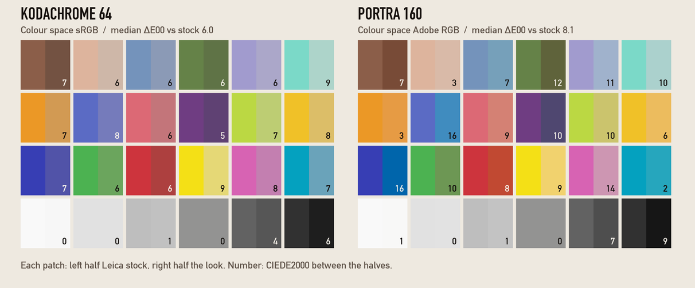
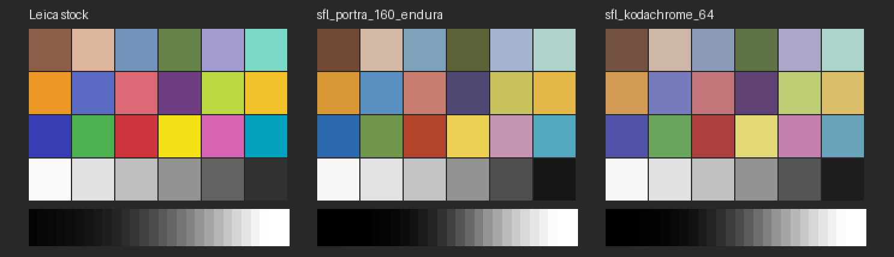

# LeicaM8

[Tiếng Việt](README.md)

Custom JPG colour (Portra, Kodachrome…) for the Leica M8, firmware 2.014, by editing `LUTS/GAMMA`
(tone curves + colour matrices). `PXA` is never touched, so the bootloader and the SD-card updater
stay stock.

Builds on [gasdevmco/leica-m8-firmware](https://github.com/gasdevmco/leica-m8-firmware) (MIT):
the `.upd` format, and GAMMA tone curves proven on a camera.

**Never commit Leica firmware.** `firmware/stock/m8-2_014.upd` (SHA-256 `99f52548…09ed0`, source:
`fichiers.touslesdrivers.com/38007/m8-2_014.zip`) and `build/` are git-ignored.

## Colour matrices (GAMMA + 0x1D0): static analysis, not yet camera-tested

- 30 3×3 matrices, int16 Q13 (8192 = 1.0); every row sums to 1.0, i.e. post-white-balance
  matrices. Two trailing int16 (`1742, 5858`) of unknown purpose.
- Index = 10·colour space + 2·saturation + variant. Space 1 = sRGB (largest determinants; 0/2 assumed
  Adobe/ECI, matching the tone-curve row order). Saturation 0..4 = Low..High (determinant rises
  monotonically).
- Variant B: at Standard it is exactly variant A with the G and B coefficients of the **red row** swapped
  (#14/#15); the other steps differ further. Meaning unknown, so builds transform every matrix on its
  own and assume nothing about A/B.
- #14 (sRGB Standard) is the closest to the camera→sRGB matrix derived from dcraw/Adobe's M8
  coefficients.

## Look research (`research/film_fit.py`)

Fits the RawTherapee HaldCLUTs (CC BY-SA 4.0) with the M8's model `curve(M · linear)`. Median ΔE00:

| Film | curve only | curve + matrix |
|---|---|---|
| Portra 160 | 5.6 | 3.2 |
| Portra 400 NC | 7.0 | 3.8 |
| Kodachrome 64 | 9.2 | 4.0 |
| Kodachrome 200 | 8.3 | 2.6 |
| Kodachrome 25 | 9.5 | 7.7 (dropped) |

A curve alone barely produces the looks; the matrix carries most of them. Per-channel curves add
nothing. Fit results: `research/fits/*.npz` (`M`, `curve` on the grid v = u^(1/2.2)).

## Colour profiles (built, not flashed, not camera-tested)

```sh
research/.venv/bin/python research/spectral_gen.py   # looks from Kodak datasheets -> research/clut/SFL *.npz
python3 research/film_fit.py "research/clut/SFL Kodachrome 64.npz" "research/clut/SFL Portra 160 Endura.npz"
python3 tools/m8lut.py build --srgb SFL_Portra_160_Endura          # one look, on stock firmware
python3 tools/m8lut.py build --base firmware/dng/m8-2_014-patched.upd \
    --srgb SFL_Kodachrome_64 --adobe SFL_Portra_160_Endura --out m8-2_014-dng14-kodachrome-portra.upd
python3 research/ccd_check.py build/X.upd "research/clut/<look>.npz" ...   # metrics + build/preview.png
```

**Look source:** [Spectral Film LUT](https://github.com/JanLohse/spectral_film_lut) (MIT): digitised Kodak
datasheets (spectral sensitivity, characteristic curves, spectral dye density) → spectral simulation of
scene → film (→ paper). Kodachrome 64 (slide, balanced on the slide's white, viewed at D65); Portra 160
printed on Kodak Portra Endura. Input is scene-linear light, matching the M8 pipeline's input. The old
RawTherapee CLUTs stay for reference only (pale Kodachrome yellows).

**Independent cross-check** (`research/spk_crosscheck.py`, run in `research/.venv-spk`): the same 24
ColorChecker patches through [spektrafilm](https://github.com/andreavolpato/spektrafilm) (GPL-3, a
different spectral simulator, also datasheet-driven): median ΔE76 between the two simulators 5.6
(Kodachrome 64), 9.6 (Portra 160 + Endura; spektrafilm renders warmer skin and stronger magenta).

Each Colour space in the menu has its own matrices and curves, so **one flash holds three looks**: a look
is defined in linear sRGB and applied on top of that space's own Leica rendering
(`T · M_look · T⁻¹ · Leica matrix`), with the curve re-encoded for the space (Adobe 2.2, ECI 1.8).
Saturation and Contrast keep working. Adobe/ECI JPGs carry their own ICC profile (gasdevmco FINDINGS);
view them in colour-managed apps.

### Combined build: 14-bit DNG + Portra + Kodachrome

`build/m8-2_014-dng14-kodachrome-portra.upd` (SHA-256 `377f544d…01ad81`):

| Colour space | JPG |
|---|---|
| sRGB | Kodachrome 64 |
| Adobe RGB | Portra 160 (Endura) |
| ECI RGB | Leica stock |

- Base = build `9b9a489a…` of [gasdevmco/leica-m8-firmware](https://github.com/gasdevmco/leica-m8-firmware)
  v0.10.0 (`python3 m8patch.py m8-2_014.upd`): persistent JPG fine+RAW + in-camera 14-bit DNG. That patch
  changes only `PXA`, the colour profiles only `GAMMA`, so they cannot overlap. `m8lut.py` accepts a base
  only if its hash is one of that project's published builds and its GAMMA is stock.
- Checked: PXA = base byte for byte; GAMMA = union of the two single builds byte for byte; ECI stock;
  everything else stock. A look in the Adobe slot, decoded to sRGB, differs from the sRGB-slot version
  by median ΔE00 2.0, the same size as Leica's own Adobe vs sRGB stock (2.3): Leica tunes each space.
- The 14-bit DNG is raw sensor data, untouched by the profiles. Precedent on a camera: gasdevmco's
  Stage 12 (baked GAMMA curves + PXA patches) ran fine; matrices are not yet proven (see Test 1).

CCD (KAF-10500) compatibility:

- **Matrix = M_look · Leica's stock matrix**, rows summing to 1 like all 30 Leica matrices: greys stay
  grey (the camera's AWB stays right), clipped CCD highlights stay neutral.
- **Tone from the film's grey axis**, black-point compensated (Dmax → 0) as in ICC perceptual; mid-grey
  at Leica's 147 (what the M8's metering is made for).
- **Shoulder**: above mid-grey the gain rolls off to 1.0 at the CCD clip point → 255 only where it clips.
- No extra shadow-noise gain, no stronger IR magenta cast.

| Build | ΔE00 vs source | clip (cam 1,1,1) | shadow noise 1% | noise 18% | IR chroma |
|---|---|---|---|---|---|
| Leica stock | | 255,255,255 | 1.00 | 1.00 | 25.5 |
| Portra 160 (Endura) | 4.3 | 255,255,255 | 0.22 | 0.76 | 12.1 |
| Kodachrome 64 | 5.0 | 255,255,255 | 0.35 | 0.80 | 17.3 |

Difference from Leica stock on a ColorChecker: median ΔE00 8.2 (Portra), 6.0 (Kodachrome), greys
unchanged. Both are **softer** than Leica's very saturated sRGB Standard. Split comparison: `docs/compare.png`.

Noise = gain relative to Leica stock. IR chroma is an **assumption** (NIR leaks into R and B more than
G); a UV/IR filter is still recommended. 3×3 matrix limit: Kodachrome yellows/blues come out lighter
than the simulation (film yellow 244,220,84 → M8 222,209,110).





## Test 1: does the Blackfin use the matrices?

```sh
python3 tools/m8lut.py bw-test     # build/m8-2_014-bwtest.upd: #14 and #15 -> monochrome, 36 bytes
python3 tools/m8lut.py dump        # print all 30 matrices
```

1. Full battery; a second card holding only the stock `m8-2_014.upd` for rollback.
2. Copy the build to a card, **rename it on the card to `M8-2_014.UPD`**, run the normal firmware update.
3. Set Colour space **sRGB**, Saturation **Standard**, shoot a JPG of a colourful scene.
4. Monochrome JPG → the matrices are used. No change → note it, flash stock back.
