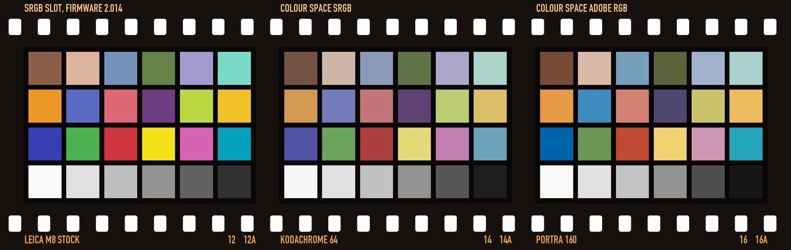
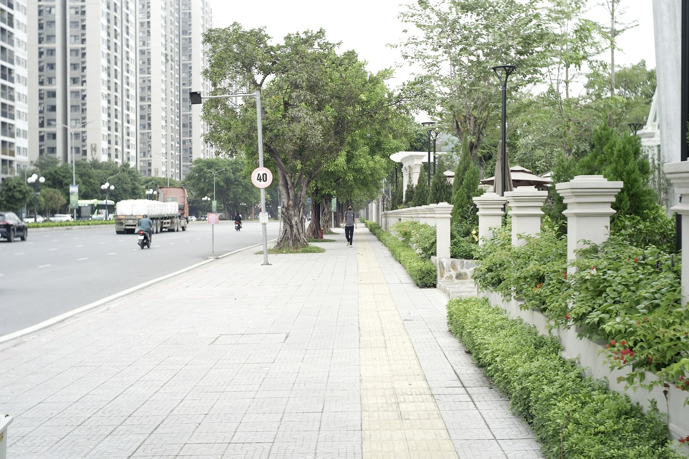
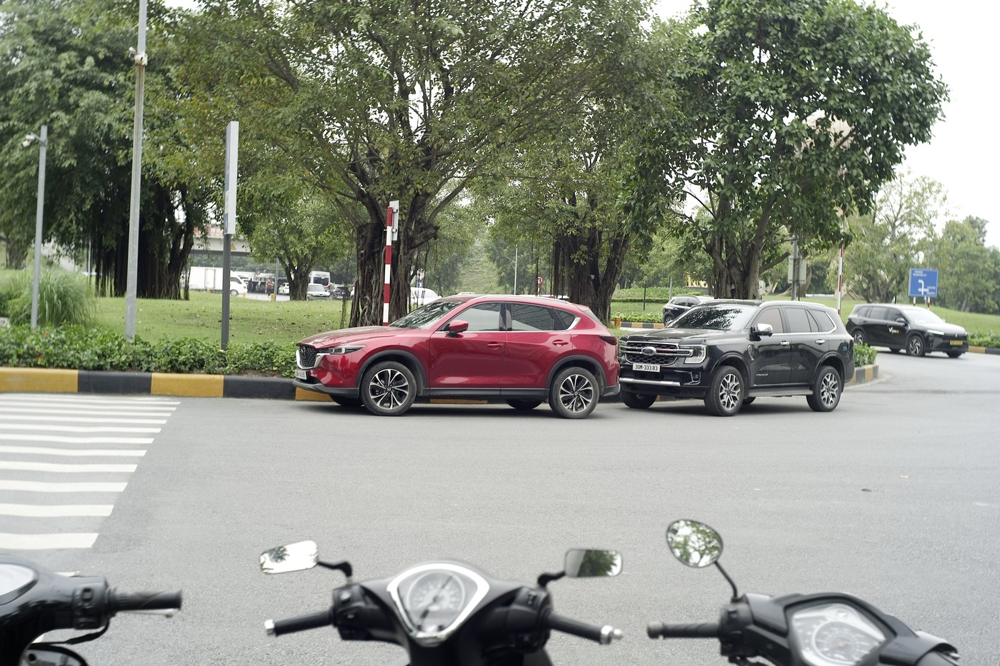
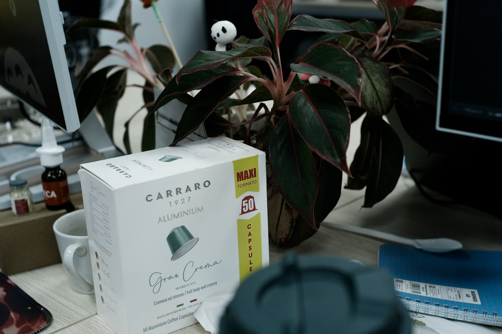
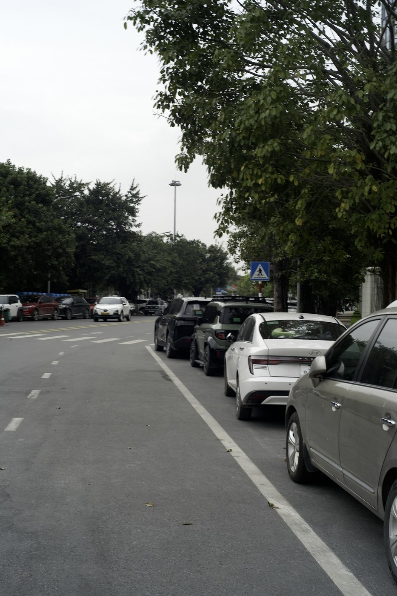
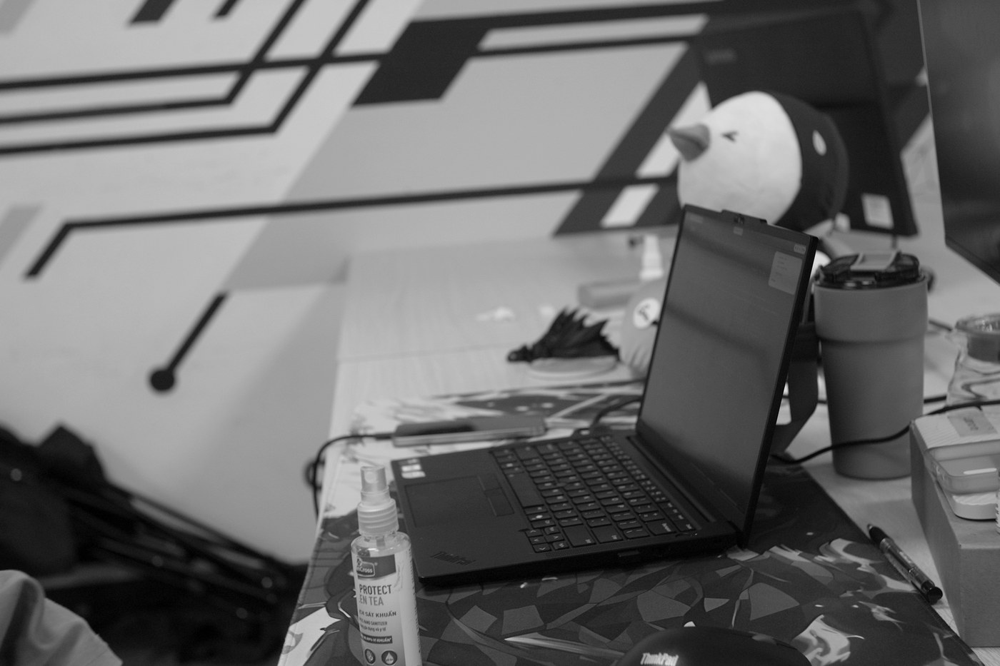
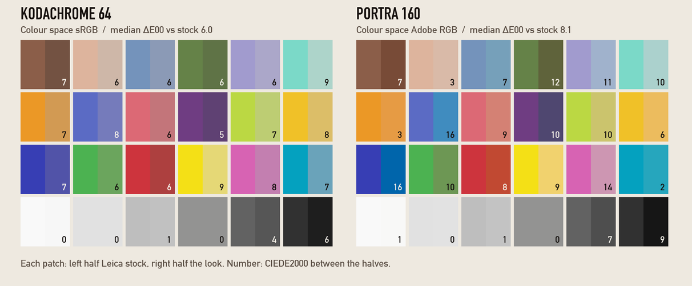
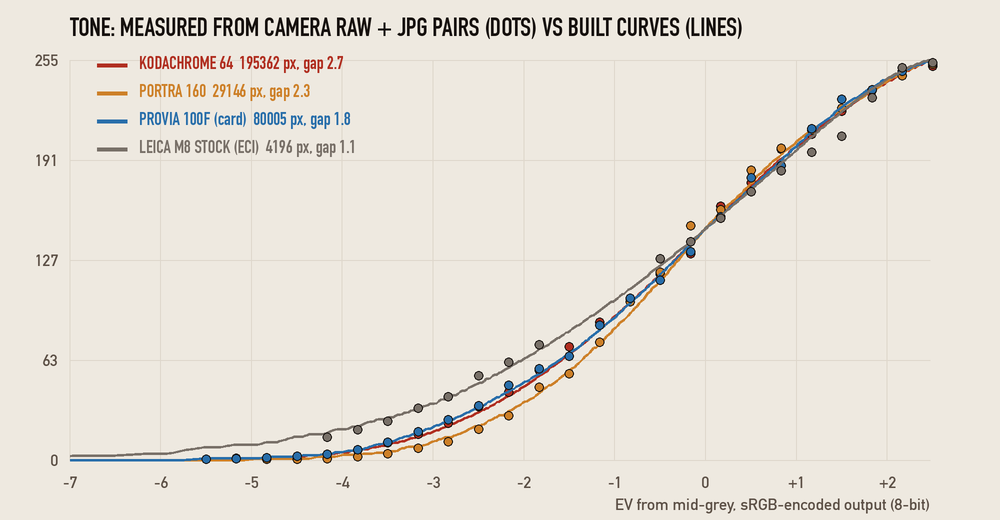

<p align="center"></p>

<h1 align="center">LeicaM8</h1>

<p align="center">
  <b>Kodachrome 64 and Portra 160 for the Leica M8's in-camera JPGs, built from Kodak datasheets.</b><br>
  One flash: two film looks, Leica's own colour, and the 14-bit DNG patch.
</p>

<p align="center">
  
  
  
  <a href="LICENSE"></a>
  <a href="README.vi.md"></a>
</p>

| Colour space (camera menu) | JPG look |
|---|---|
| sRGB | Leica stock; Saturation Low = black & white |
| Adobe RGB | Kodachrome 64, slide viewed at D65 |
| ECI RGB | Portra 160 printed on Kodak Portra Endura |

This project edits `LUTS/GAMMA` (colour matrices + tone curves) and, with `--raw-default`, one
instruction of the factory-settings template. The optional base, a 14-bit DNG build of
[gasdevmco/leica-m8-firmware](https://github.com/gasdevmco/leica-m8-firmware) (MIT), edits only `PXA`
code. They never overlap; the bootloader and SD-card updater stay stock.

> [!WARNING]
> Experimental firmware on a 20-year-old camera, at your own risk. Keep a card with the stock
> `m8-2_014.upd` to roll back.

## What's working

Tested on one M8 (firmware 2.014): 2026-11-17/18 with the earlier layout (Kodachrome in sRGB, Portra in
Adobe RGB, B&W in ECI), 2026-11-20 with the current layout (44 JPG+RAW pairs, L…391–436).

| Feature | Status | Evidence |
|---|---|---|
| GAMMA colour matrices drive the JPG | ✅ camera | `bw-test`: sRGB JPG exactly monochrome (R = G = B in every pixel), Adobe RGB shot of the same scene in colour |
| Kodachrome 64 (Adobe RGB) | ✅ camera | 2026-11-20, 34 shots: JPG predicted from its own 14-bit RAW within 1–9 levels with the flashed table vs 5–14 with Leica's (earlier layout in sRGB: ΔE00 3.5 vs 6.9) |
| Portra 160 on Endura (ECI RGB) | ✅ camera | 2026-11-20, 6 shots: 3–5 levels with the flashed table vs 11 with Leica's (11 vs 17 at ISO 1250); ECI-RGB.icc embedded |
| Leica stock (sRGB, profile 0) | ✅ camera | 2026-11-20, 3 shots: sRGB slot byte-identical to stock, both tables predict the JPG equally |
| Black & white (sRGB, Saturation Low) | ✅ camera | 2026-11-20, L…391: R = G = B in every pixel |
| 14-bit DNG (`.RAW`, 21,049,052 bytes) | ✅ camera | 5/5 pairs: AsShotNeutral == JPG, 18/18 MakerNote tags == JPG (gasdevmco `m8_metacheck`) |
| JPG fine+RAW kept through power cycles | ✅ camera | gasdevmco patch; every shot since gave JPG + RAW |
| `--raw-default` (factory default JPG fine+RAW) | ✅ camera | 2026-11-20: every shot after the flash gave JPG + RAW; profile 0 at 0 EV |
| Rear dial: EV, UP/DOWN → ISO | ✅ pieces on camera (gasdevmco), ⏳ this build | picker + dial combination: gasdevmco `m8_evtest` 260/0 |
| Picture-profile picker, `.LUT` card looks | ✅ picker on camera (gasdevmco, curves), ⏳ colour | `TRIX400.LUT` (all-equal matrix rows) decides whether a re-sent GAMMA also carries the matrices |
| User profiles | ✅ camera | profiles 1–3 saveable and keep Colour space, Contrast, EV, ISO and WB (2026-11-20); 0 is the factory default, rebuilt at every power-on |
| Clipped CCD highlights stay neutral | ✅ camera | `research/matrix_bench.py`: 144k RAW-clipped px, JPG chroma median 0, p95 4–9 levels |

### Sample shots (camera JPGs, overcast morning, 2026-11-18)

Straight out of the camera, resized, EXIF stripped; Adobe/ECI converted to sRGB for display.

<p align="center">
  
  
</p>
<p align="center">
  
  
  
</p>

Shot with the earlier layout. Top: Kodachrome 64 (then sRGB). Middle: Portra 160 (then Adobe RGB, indoor) and Provia 100F loaded
from the card (`PROVIA.LUT`). Bottom: black & white (ECI, Saturation Low).

Known limits: one 3×3 matrix + one curve per slot (Kodachrome yellows/blues lighter than the
simulation); looks are in the JPG only; card looks last until power-off; Adobe/ECI JPGs need
colour-managed viewing.


**Never commit Leica firmware.** `firmware/stock/m8-2_014.upd` (SHA-256 `99f52548…09ed0`, source:
`fichiers.touslesdrivers.com/38007/m8-2_014.zip`) and `build/` are git-ignored.

<p align="center"></p>

## Setup on the camera

Recommended build: `--base` gasdevmco's `dng --meta --profiles --dial-ev --iso` file (`cf965505…`; picker + dial EV/ISO, all pieces camera-tested by gasdevmco, the combination emulator-tested: m8_evtest 260/0),
`--adobe SFL_Kodachrome_64 --eci SFL_Portra_160_Endura --bw srgb --raw-default`, plus the card looks
(`build/PROFILES`, see *More looks from the card*). Profile 0 (sRGB Standard, 0 EV) stays Leica stock.
The looks, B&W and the 14-bit DNG are camera-checked in the earlier layout (2026-11-17, on the
`--dial-ev` base; the PXA pieces of this base were camera-tested by gasdevmco as this exact file).

```sh
python3 tools/m8lut.py build --base firmware/dng/m8-2_014-dng-profiles-dial-iso.upd \
    --adobe SFL_Kodachrome_64 --eci SFL_Portra_160_Endura --bw srgb --raw-default \
    --out m8-2_014-dng14-picker-dialiso-stock0-kodachrome-portra-bw-raw.upd
```

**1. Flash** (Leica's procedure)

1. Full battery. Keep a second card holding only the stock `m8-2_014.upd` for rollback.
2. Format the card **in the camera**, then on the computer copy the build to the card root and rename it
   there to `M8-2_014.UPD` (only one `.UPD` on the card). On macOS remove `._*` files:
   `dot_clean -m /Volumes/CARD; rm -f /Volumes/CARD/._*`. Check the SHA-256 on the card.
3. Card in, switch on, wait 3 s, confirm the update. About 3 minutes; the bar pauses near 60 %.
   **Don't touch the switch, battery or card until it asks for a restart.** Then off and on.
4. Copy the `PROFILES` folder (the `.LUT` files) to the card root, next to `DCIM`.

The update resets every setting, so set the profiles again after each flash.

**2. User profiles** (MENU → *Save User Profile*). Only **profiles 1–3 can be saved**; profile 0 is
the factory default, rebuilt at every power-on.

| Profile | Color Management | Saturation | Contrast | EV | ISO | WB | Use |
|---|---|---|---|---|---|---|---|
| 0 (factory, not saveable) | sRGB | Standard | Standard | 0 | 160 | Auto | Leica stock |
| 1 | Adobe RGB | Standard | Standard | **−⅓** | **160** | Auto | **Kodachrome 64**, sun, street |
| 2 | ECI RGB | Standard | **Medium Low** | **+⅔** | ≤ **640** | Auto; **Fluorescent** only under office light | **Portra 160**, people, indoor |
| 3 | sRGB | **Low** | **Medium High** | 0 | up to 1250 | Auto | Black & white, Tri-X-like punch |

All in JPG fine+RAW. Why, from the camera tests (2026-11-17/18, `tests/shots`, 27 pairs):

- **Kodachrome −⅓ EV**: overcast street shots with sky in the frame clipped 14–23 % of the frame *in the
  RAW* (scene median 2–3× mid-grey); dial further down (−⅔) only when the sky is large. In shade or under
  trees use 0 to +⅔: at −⅔ such shots (2026-11-20) were 30–73 % near black with nothing clipped in the RAW.
- **WB Auto**: fixed WB saved in a profile follows it everywhere. Portra saved with an indoor WB came out
  blue outdoors (b\* −6…−10); Kodachrome with Daylight left greys slightly green (a\* −5…−6).
- **Portra +⅔ EV, Contrast Medium Low**: indoor Portra shots were ~1.6 stops under mid-grey with 12–15 %
  of pixels near black; Portra's curve has deeper shadows than Leica's.
- **WB indoors**: under office LED/fluorescent light Auto WB left greys green (a\* −3…−6) in Portra *and*
  Leica stock, so it is the camera's AWB, not the look. Daylight shots were neutral (a\*/b\* ≈ −1/+1).
- **ISO ≤ 640** for colour: the M8 CCD is noisy at 1250; the looks add no noise gain but can't hide it.
  B&W has no chroma noise, so 1250 reads as grain.
- **B&W at EV 0**: the +1 EV test shot clipped 53 % of the frame; at 0 EV nothing clipped or crushed.

- Profile 0 can't be configured; with `--raw-default` its defaults are sRGB, Standard, JPG fine+RAW, 0 EV,
  i.e. Leica stock.
- Other Saturation/Contrast steps keep working on top of each look.
- Adobe RGB and ECI RGB JPGs carry their ICC profile: view or export them in colour-managed apps
  (Lightroom, Photos, browsers); convert to sRGB before posting to apps that ignore ICC.
- The look is in the JPG only. The `.RAW` (14-bit DNG; rename to `.DNG` outside Lightroom) is raw data,
  white balance "As Shot" = the JPG's.

**3. Card looks** (picture-profile picker): in shooting mode INFO → UP → choose a look → SET → INFO.
The look replaces sRGB Saturation Standard (profile 0, Leica stock) until power-off; Kodachrome, Portra and
B&W stay. Load `DEFAULT` to go back without switching off. First time: load `TRIX400` and shoot sRGB
Standard; a black & white JPG means card looks carry their colour (the Tri-X matrix is monochrome), a
colour JPG with Tri-X tone means only their tone (then prefer the `--dial-ev` build).

**4. Check**

- SET → Compression shows JPG fine+RAW, and still does after a power cycle.
- Each shot gives `L…JPG` + `L…RAW` (21,049,052 bytes).
- Rear dial in shooting mode: first click opens EV, then ⅓ EV per click; UP/DOWN switches to ISO.
- Same scene in each profile: `python3 research/shot_check.py build/<flashed>.upd tests/shots/L*.JPG`
  (needs rawpy) should report "flashed look" for the sRGB and Adobe RGB shots.

**If something goes wrong:** pull the battery (not the switch, not the card), power on, set
Compression to JPG fine, flash the stock file from the rescue card.

## Colour matrices (GAMMA + 0x1D0): camera-tested

**Camera test 2026-11-17** (`bwtest.upd`, `68534e37…`, M8 on 2.014, ISO 160, 1/60 s): the sRGB JPG
(EXIF ColorSpace 1, Saturation/Contrast Standard) came out **exactly monochrome** (R = G = B in every
pixel) and darker (control curve); the same scene in Adobe RGB (embedded ICC "Adobe RGB (1998)") stayed
in colour. So the Blackfin uses these matrices, #14/#15 is sRGB Standard, and the space mapping holds.

- 30 3×3 matrices, int16 Q13 (8192 = 1.0); every row sums to 1.0, i.e. post-white-balance
  matrices. Two trailing int16 (`1742, 5858`) of unknown purpose.
- Index = 10·colour space + 2·saturation + variant. Space 1 = sRGB (largest determinants; 0/2 assumed
  Adobe/ECI, matching the tone-curve row order). Saturation 0..4 = Low..High (determinant rises
  monotonically).
- Variant B: at Standard it is exactly variant A with the G and B coefficients of the **red row** swapped
  (#14/#15); the other steps differ further. **Camera: Saturation Standard uses variant B** — the matrix
  recovered from RAW+JPG pairs (`research/matrix_bench.py`) is 0.22 from B vs 1.12 from A in Adobe RGB
  (486k coloured px) and 0.28 vs 1.12 in ECI RGB (433k px). What selects A is unknown, so builds transform both.
- #14 (sRGB Standard) is the closest to the camera→sRGB matrix derived from dcraw/Adobe's M8
  coefficients.

## Look research (`research/film_fit.py`)

Fits the RawTherapee HaldCLUTs (CC BY-SA 4.0) with the M8's model `curve(M · linear)`. Median ΔE00:

| Film | curve only | curve + matrix |
|---|---|---|
| Portra 160 | 5.6 | 3.2 |
| Portra 400 NC | 7.0 | 3.8 |
| Kodachrome 64 | 9.2 | 4.0 |
| Kodachrome 200 | 8.3 | 2.6 |
| Kodachrome 25 | 9.5 | 7.7 (dropped) |

A curve alone barely produces the looks; the matrix carries most of them. Per-channel curves add
nothing. Fit results: `research/fits/*.npz` (`M`, `curve` on the grid v = u^(1/2.2)).

## Colour profiles (built, not flashed, not camera-tested)

```sh
research/.venv/bin/python research/spectral_gen.py   # looks from Kodak datasheets -> research/clut/SFL *.npz
python3 research/film_fit.py "research/clut/SFL Kodachrome 64.npz" "research/clut/SFL Portra 160 Endura.npz"
python3 tools/m8lut.py build --srgb SFL_Portra_160_Endura          # one look, on stock firmware
python3 tools/m8lut.py build --base firmware/dng/m8-2_014-patched.upd \
    --srgb SFL_Kodachrome_64 --adobe SFL_Portra_160_Endura --out m8-2_014-dng14-kodachrome-portra.upd
python3 research/ccd_check.py build/X.upd "research/clut/<look>.npz" ...   # metrics + build/preview.png
```

**Look source:** [Spectral Film LUT](https://github.com/JanLohse/spectral_film_lut) (MIT): digitised Kodak
datasheets (spectral sensitivity, characteristic curves, spectral dye density) → spectral simulation of
scene → film (→ paper). Kodachrome 64 (slide, balanced on the slide's white, viewed at D65); Portra 160
printed on Kodak Portra Endura. Input is scene-linear light, matching the M8 pipeline's input. The old
RawTherapee CLUTs stay for reference only (pale Kodachrome yellows).

**Independent cross-check** (`research/spk_crosscheck.py`, run in `research/.venv-spk`): the same 24
ColorChecker patches through [spektrafilm](https://github.com/andreavolpato/spektrafilm) (GPL-3, a
different spectral simulator, also datasheet-driven): median ΔE76 between the two simulators 5.6
(Kodachrome 64), 9.6 (Portra 160 + Endura; spektrafilm renders warmer skin and stronger magenta).

Each Colour space in the menu has its own matrices and curves, so **one flash holds three looks**: a look
is defined in linear sRGB and applied on top of that space's own Leica rendering
(`T · M_look · T⁻¹ · Leica matrix`), with the curve re-encoded for the space (Adobe 2.2, ECI 1.8).
Saturation and Contrast keep working. Adobe/ECI JPGs carry their own ICC profile (gasdevmco FINDINGS);
view them in colour-managed apps.

### `--raw-default`: JPG fine+RAW as the factory default

A firmware update resets the camera's settings (Leica's note), so the profiles must be set again
after every flash. `--raw-default` changes **one register field in one instruction** of the factory
profile template (`0x20FF4`: `strh lr` → `strh r7`, compression 1 → 5); no new code. Records reset to
defaults and profile 0 (rebuilt at every boot) then start in JPG fine+RAW; a valid EEPROM keeps the
owner's settings. Needs a base with the persistent-RAW patch (the tool checks it). Simple mode gets
JPG fine+RAW too. Emulator: `research/settings_emutest.py` runs the camera's real defaults/loader/crc32
code from base and build: 24/24, only the six compression bytes differ, same firmware calls.

### Combined build: 14-bit DNG + Portra + Kodachrome

`build/m8-2_014-dng14-kodachrome-portra.upd` (SHA-256 `377f544d…01ad81`):

| Colour space | JPG |
|---|---|
| sRGB | Kodachrome 64 |
| Adobe RGB | Portra 160 (Endura) |
| ECI RGB | Leica stock |

- Base = build `9b9a489a…` of [gasdevmco/leica-m8-firmware](https://github.com/gasdevmco/leica-m8-firmware)
  v0.10.0 (`python3 m8patch.py m8-2_014.upd`): persistent JPG fine+RAW + in-camera 14-bit DNG. That patch
  changes only `PXA`, the colour profiles only `GAMMA`, so they cannot overlap. `m8lut.py` accepts a base
  only if its hash is one of that project's published builds and its GAMMA is stock.
- Checked: PXA = base byte for byte; GAMMA = union of the two single builds byte for byte; ECI stock;
  everything else stock. A look in the Adobe slot, decoded to sRGB, differs from the sRGB-slot version
  by median ΔE00 2.0, the same size as Leica's own Adobe vs sRGB stock (2.3): Leica tunes each space.
- The 14-bit DNG is raw sensor data, untouched by the profiles. Precedent on a camera: gasdevmco's
  Stage 12 (baked GAMMA curves + PXA patches) ran fine; matrices are not yet proven (see Test 1).

CCD (KAF-10500) compatibility:

- **Matrix = M_look · Leica's stock matrix**, rows summing to 1 like all 30 Leica matrices: greys stay
  grey (the camera's AWB stays right), clipped CCD highlights stay neutral.
- **Tone from the film's grey axis**, black-point compensated (Dmax → 0) as in ICC perceptual; mid-grey
  at Leica's 147 (what the M8's metering is made for).
- **Shoulder**: above mid-grey the gain rolls off to 1.0 at the CCD clip point → 255 only where it clips.
- No extra shadow-noise gain, no stronger IR magenta cast.

| Build | ΔE00 vs source | clip (cam 1,1,1) | shadow noise 1% | noise 18% | IR chroma |
|---|---|---|---|---|---|
| Leica stock | | 255,255,255 | 1.00 | 1.00 | 25.5 |
| Portra 160 (Endura) | 4.3 | 255,255,255 | 0.22 | 0.76 | 12.1 |
| Kodachrome 64 | 5.0 | 255,255,255 | 0.35 | 0.80 | 17.3 |

Difference from Leica stock on a ColorChecker: median ΔE00 8.2 (Portra), 6.0 (Kodachrome), greys
unchanged. Both are **softer** than Leica's very saturated sRGB Standard. Split comparison: `docs/compare.png`.

Noise = gain relative to Leica stock. IR chroma is an **assumption** (NIR leaks into R and B more than
G); a UV/IR filter is still recommended. 3×3 matrix limit: Kodachrome yellows/blues come out lighter
than the simulation (film yellow 244,220,84 → M8 222,209,110).

<p align="center"></p>

**Measured on the camera** (`research/curve_bench.py`): every matrix row sums to 1, so a pixel that is
neutral in the RAW reaches the curve unchanged and its JPG value is the curve itself. 21 RAW+JPG pairs
(2026-11-17/18) trace each curve from −6.5 to +2.4 EV within a median **1–3 levels** of the built one
(Kodachrome 2.7, Portra 2.4, Provia from the card 1.8, Leica stock 1.7); the raw level goes straight into
the curve (fitted exposure scale 1.000–1.025).

Images: `python3 docs/make_images.py` renders them from the built `.upd` (matrices + curves read back
from the file); nothing is painted by hand.

## More looks from the card (picture-profile picker)

gasdevmco's picker (v0.7.0 `--profiles`, withdrawn from `m8patch.py` because the author "doesn't like
how it works", not for a fault) loads a whole 31,760-byte `GAMMA` from `\PROFILES\*.LUT` until
power-off: INFO → UP → choose → SET. Its build `4359b04b…` (DNG + meta + picker + dial, amber) was
flashed and camera-tested as that exact file, so it is an accepted base here.

```sh
python3 tools/m8lut.py build --base firmware/dng/m8-2_014-dng-profiles-dial-iso.upd \
    --adobe SFL_Kodachrome_64 --eci SFL_Portra_160_Endura --bw srgb --raw-default \
    --out m8-2_014-dng14-picker-dialiso-stock0-kodachrome-portra-bw-raw.upd
python3 tools/m8lut.py lut --from build/m8-2_014-dng14-picker-dialiso-stock0-kodachrome-portra-bw-raw.upd \
    --name VELVIA50 --srgb SFL_Velvia_50 --bw srgb   # -> build/PROFILES/VELVIA50.LUT
```

- Every `.LUT` starts from the **flashed** GAMMA and changes only the sRGB slot; `--bw srgb` keeps
  sRGB Saturation Low black & white, so loading one never wipes Kodachrome (Adobe), Portra (ECI) or B&W.
  The picker checks only size + the first 24 header bytes, which the looks never touch.
  `DEFAULT.LUT` = the flashed table; power-off also restores it.
- Card set (all 10 of the picker's slots): `DEFAULT`, `PORTRA16`, `PORTRA4`, `GOLD200`, `EKTAR100`,
  `PRO400H`, `EKTA100`, `VELVIA50`, `PROVIA`, `TRIX400` (fit ΔE00: Tri-X 1.1, Pro 400H 3.4, Gold 4.2,
  Portra 400 4.3, Ektar 4.7, Provia 4.8, Ektachrome 5.1, Velvia 5.8). Pro 400H prints on Fuji Crystal
  Archive Maxima, Ektar 100 on Kodak Endura Premier.
- Unproven: that the Blackfin takes **matrices** from a re-sent GAMMA (gasdevmco proved curves only).
  Load `TRIX400.LUT`, shoot sRGB: black & white = yes; colour = curves only (looks lose their colour half).
- `.LUT` files contain Leica data: build them yourself, never publish them.
- Costs: no INFO Camera-stats-only screen (the picker includes it), dial pages amber, card looks
  last until power-off.

## Test 1: does the Blackfin use the matrices?

```sh
python3 tools/m8lut.py bw-test         # #14/#15 -> monochrome, curve 7 -> 0.6x output (control)
python3 tools/m8lut.py bw-test --all   # all 30 matrices + all 15 curves, same changes
python3 tools/m8lut.py dump            # print all 30 matrices
```

The darker curve is a control on the path already proven on hardware (gasdevmco Stage 11/12): it
shows the GAMMA table really loaded, so a colour JPG can't be mistaken for a failed flash.

1. Full battery; a second card holding only the stock `m8-2_014.upd` for rollback.
2. Copy `bwtest.upd` to a card, **rename it on the card to `M8-2_014.UPD`**, run the firmware update.
3. Colour space **sRGB**, Saturation **Standard**, Contrast **Standard**; shoot a colourful scene, JPG.

| JPG | Meaning | Next |
|---|---|---|
| dark + B&W | matrices used, slot guess right | flash the look build |
| dark + colour | curves used; #14/#15 not used (wrong slot, or matrices live elsewhere) | flash `bwtest-all.upd`, same shot |
| normal + colour | GAMMA not loaded, or other settings | check the JPG's Colour space / Saturation / Contrast in EXIF, flash again |

With `bwtest-all.upd`: B&W in any setting → matrices used, my slot mapping is wrong; bisect it.
Still colour → these 30 matrices don't drive the JPG; only the tone half of the looks works
(curve-only fits barely move ΔE), so don't flash the look builds; the colour stage then lives in the
Blackfin code or another LUT (`LEICA`, `GAIN`) and needs Blackfin disassembly.
